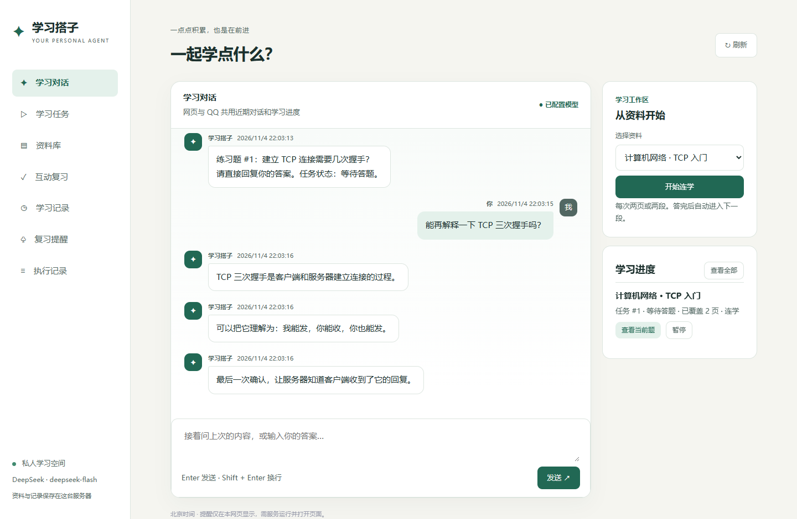

# 学习搭子 · Personal Learning Agent

**v0.4.0 · 邀请同学试用**

这是一个围绕自己学习资料使用的个人 Agent。可以上传资料，通过网页或官方 QQ 机器人提问，并按步骤完成“读资料 → 讲解 → 出题 → 答题 → 继续”。

项目使用 Python、FastAPI、SQLite 和 DeepSeek API，网页使用 HTML、CSS、JavaScript，没有前端构建步骤。代码、测试与部署过程使用了 AI 编程助手辅助，第一版保留了适合学习的简单模块划分和关键注释。这是一个可运行的学习原型，还有明确的使用限制。



截图来自 v0.2.0 的本机网页，使用演示资料和模拟模型响应。

## 当前版本能做什么

- 上传 PDF、DOCX、UTF-8 TXT 和 Markdown，保存提取后的文字。
- 检索资料、引用 PDF 页码或 Word 片段编号，读取指定位置。
- 根据资料讲解、出题、批改，并保存错题。
- 建立分块学习任务，记录已覆盖位置、当前题目和下一块位置；支持暂停与继续。
- 一次提问后接连发出两到三条独立消息。网页按顺序显示气泡，QQ 单聊按回复序号分别发送。
- 选资料开启「连学」，在对话里答题后自动进入下一块。常见追问会保留当前待答题，可用「答：」明确提交答案。
- 缓存重复的资料关键词检索，资料变动后失效。网页「执行记录」会标出实时检索与缓存命中。
- 学习进度先进入待确认区，需要用户在网页确认，才成为正式学习记录。
- 网页管理资料、任务、题目、记录和提醒；QQ 单聊复用同一个后端。
- 课程分别保存资料、任务、题目、学习记录和提醒。课程内可创建多个会话，各自保留聊天和执行记录。
- SQLite 保存数据；模型失败时不推进该块的学习游标，已成功的步骤可复用。

## 本地运行

建议使用 Python 3.11。代码曾在 Windows Python 3.9.13 跑通过测试，用户部署环境为 Ubuntu / Python 3.14；不同环境仍需实际验证依赖安装。

```bash
git clone https://github.com/jjh-python667/personal-learning-agent.git
cd personal-learning-agent
python -m venv .venv
```

激活虚拟环境：

```powershell
# Windows PowerShell
.\.venv\Scripts\Activate.ps1
```

```bash
# Linux / macOS
source .venv/bin/activate
```

安装依赖，把 `.env.example` 复制为 `.env`（可直接通过文件管理器复制），再填写自己的配置：

```bash
python -m pip install -r requirements.txt
python -m uvicorn main:app --host 127.0.0.1 --port 8000 --workers 1
```

配置中的 `DEEPSEEK_API_KEY` 用于模型调用；`DEEPSEEK_MODEL` 填账户当前可用的模型名；`APP_PASSWORD` 自行设置为足够长的随机密码。修改配置后需重启。未配置 API Key 时，仍可手动管理资料。

打开 <http://127.0.0.1:8000>。管理员用户名是 `admin`，密码是 `APP_PASSWORD`。同学不使用这个密码：管理员在网页「邀请同学」里生成链接，同学自己注册。步骤用大白话写在 [怎么试用](docs/TRY.md)。发给同学的地址需要 HTTPS，配置见 [部署说明](docs/DEPLOYMENT.md)。

也可使用 Windows 的 `start.ps1` 完成虚拟环境创建、依赖安装及启动。

## 建议这样体验

升级后，已有资料和历史归入「默认课程 / 默认会话」。在页面上方新建课程或会话，再通过下拉菜单切换。上传资料和开始任务前先确认选中了对应课程。

要在 QQ 继续网页里的对话，可以点击「在 QQ 继续此会话」。也可以给机器人发送「列出会话」，再发送「切换会话 2」，把编号换成列表中实际显示的值。

1. 在“资料库”上传自己有权使用的资料，记住网页中的资料编号。
2. 发“请列出我的资料”，检查清单。
3. 发“带我学完编号1的PDF，每次两页，讲完出一道题”。编号按实际情况替换。
4. 默认模式下，回答当前题目后再说“继续”。也可以在网页点击「开始连学」，或在开始指令里加上「开启连学」，在对话中答题后会自动进入下一块。
5. 说“暂停”或“继续任务1”，也可使用网页“学习任务”中的按钮。
6. 重启服务，再查看任务和已保存资料。多个可继续任务会要求选择编号。

Word 没有固定页码，任务按提取后的片段推进。已覆盖表示程序处理过对应内容，不代表用户已经掌握知识。

## 代码怎么分工

- `main.py`：网页接口、登录和邀请入口、上传文件和人工确认操作。
- `auth.py`：管理员账号、同学邀请、登录 Cookie。QQ 不在这里做多人。
- `limits.py`：每天次数、发送间隔、同时请求数和上传大小。
- `guide.py`：第一次选择示例或自己的资料，以及五步引导。
- `agent.py`：请求模型，检查工具参数，执行工具，再把结果交回模型。
- `lesson.py`：学习任务状态和分块流程，决定什么时候推进游标。
- `db.py`：数据库连接、保存记录和关键词检索。
- `word_import.py`：从 DOCX 提取文字，限制文件大小和 XML 内容。
- `qq_bridge.py`：接收绑定用户的 QQ 消息，转给同一个网页后端。
- `static/`：管理网页。
- `tests/`：使用临时数据库和模拟模型响应的测试。

普通对话允许模型选择工具；资料列表请求和学习任务的关键步骤由程序控制。模型生成的文本不直接决定数据库进度。详细入门说明见 [代码阅读笔记](docs/CODE_GUIDE.md)。

## 测试与当前状态

```bash
python -m unittest discover -s tests -v
```

本版 **51 项本地测试通过**。测试使用临时数据库和模拟模型响应，覆盖课程和会话分离、旧数据迁移、双账号隔离、邀请收回、额度、分条回复、连学和缓存。

真机整页、真实 QQ 和 DeepSeek 收发仍需部署后实测。详见 [验证记录](docs/VALIDATION.md) 和 [v0.4 验收](docs/ACCEPTANCE_v0.4.md)。v0.3 的浏览器检查不能当成这一版邀请页面已经点过。代码和测试由 AI 编程助手协助完成，验收范围以那份记录为准。

## QQ 与服务器部署

QQ 是可选功能，需要自己在 QQ 开放平台创建官方机器人，并具备对应场景权限：

```bash
python -m pip install -r requirements-qq.txt
python qq_bridge.py
```

先在 `.env` 配置 `QQ_APP_ID`、`QQ_APP_SECRET`、`APP_PASSWORD`。首次未填写 `QQ_OWNER_OPENID` 时不会执行收到的请求，只在终端记录发送人的 OpenID。自己发送一条测试消息，确认发信身份后配置该值并重启。只允许绑定的主人使用，QQ 不需要个人账号密码。

Linux 首次安装及 systemd 配置见 [部署说明](docs/DEPLOYMENT.md)。网页默认只监听本机，远程使用时通过 SSH 隧道访问。公开互联网访问需要自行配置 HTTPS 等保护，不能直接把默认服务开放给所有人。

## 当前限制

- 网页可以邀请同学，每个人只看到自己的资料和进度。QQ 仍是单人：只处理 `QQ_OWNER_OPENID`，不能用来试同学的账号。
- 智能提问有每天次数、发送间隔和同时个数限制，用完会提示明天再来。列出资料不占次数。
- 登录没有失败锁定。请用较长密码，并把公网入口放在 HTTPS 后面。
- 不支持扫描件 OCR、旧版 `.doc`、Word 图片与复杂排版。文件最多 12MB；PDF 最多120页，Word 提取文字最多30万字符。
- 资料检索使用关键词与中文相邻双字，不是语义向量检索。
- 单页给模型的文本最多6000字符；超长页不会全部覆盖，第一版尚未做页内细分。不要用于需要完整逐字审阅的任务。
- 有唯一待答题任务时，普通消息可能被当作答案；建议先答题或暂停再闲聊。多任务时可在网页选择具体题目作答。
- 网页“继续”返回的详细讲解未完整展示在任务卡片；完整交互建议通过对话或 QQ 进行。
- 批改由模型生成，可能出错。默认答题后手动继续。连学模式每次推进一块，到下一道题时等待回答。
- 提醒只在打开网页时显示，不承诺 QQ 主动推送。
- 普通工具对话仍可能漏调用工具；列表与任务路径做了程序约束，不代表所有请求均可靠。
- 运行中任务不能跨多个后端进程并发调度，请保持一个 worker。不支持自动恢复重启前正在运行的模型请求。

## 隐私与开源

API Key、网页密码、QQ Secret 都留在后端。上传内容在请求模型处理时会发送给 DeepSeek，使用前请确认资料可以发送。数据库包含聊天和个人资料，不要提交到 GitHub。

本仓库不包含真实配置、私人文档、生产数据库、SSH密钥或服务器地址。许可证为 [MIT](LICENSE)。依赖库仍遵守各自许可证。

参考了 [DeepSeek Super-agent 原型](https://github.com/deepseek-ai/dsh-superagent-prototype) 的任务状态、持久记录与执行证据设计；本项目没有引入其源码，也没有实现多执行器或 GitHub 工单系统。模型接口参考 [DeepSeek 文档](https://api-docs.deepseek.com/)，QQ 接入使用 [腾讯官方 botpy SDK](https://github.com/tencent-connect/botpy)。

版本变更见 [CHANGELOG](CHANGELOG.md)。每版为什么改、碰到了什么问题、怎么验证，见 [开发日志](docs/DEV_LOG.md)。具体代码改动可从 GitHub 的提交记录和版本标签对照查看。
