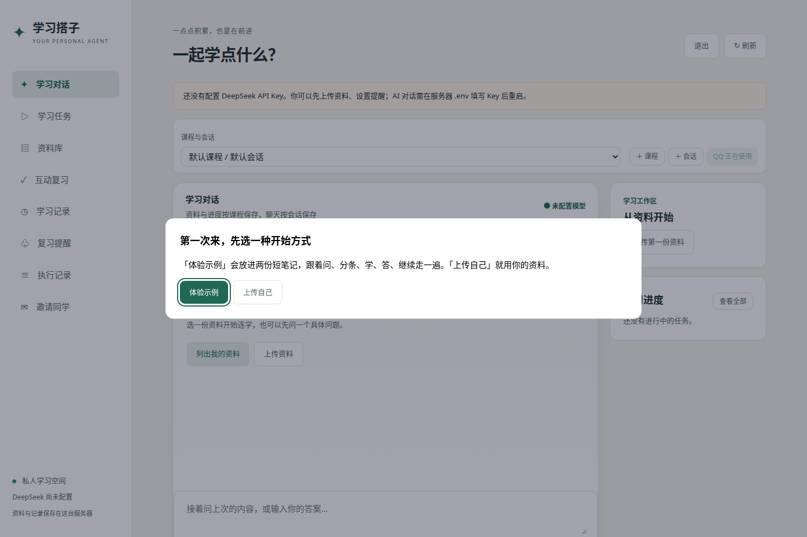
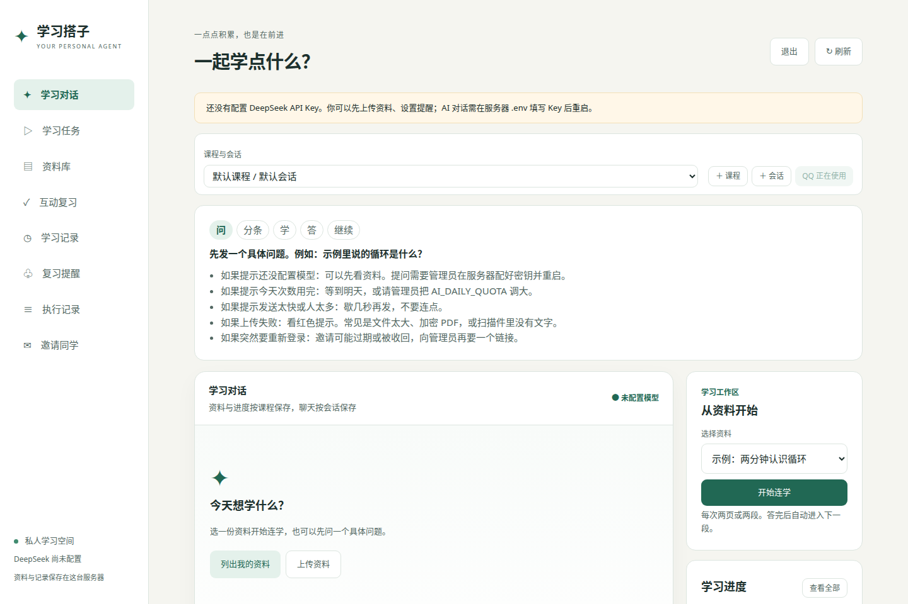
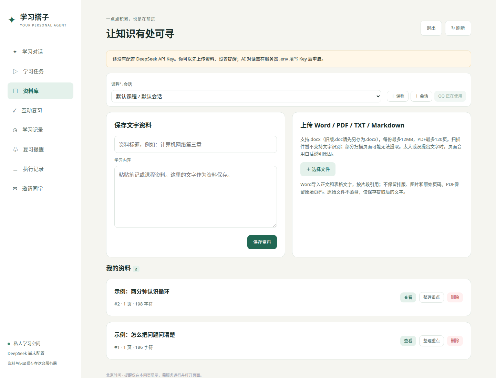
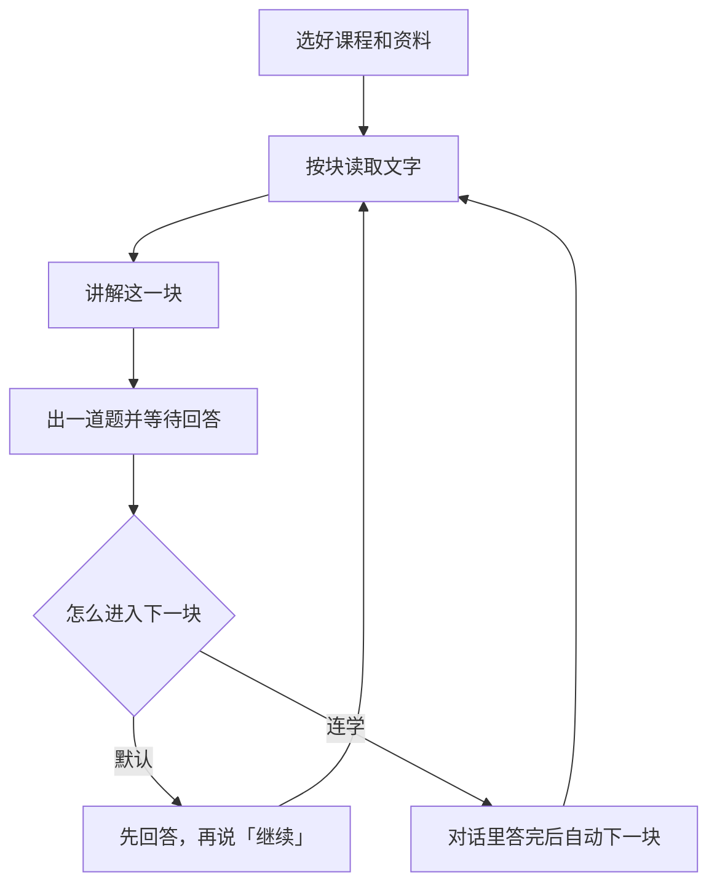

# 学习搭子

Personal Learning Agent · v0.4.0

[](https://github.com/jjh-python667/personal-learning-agent/actions/workflows/tests.yml)

**中文。** 这是一个围绕自己的学习资料使用的个人 Agent。可以上传 PDF、DOCX、UTF-8 TXT 或 Markdown，在网页里提问，也可以选配官方 QQ 机器人。学习可以按块进行：读一段、讲解、出一道题、答题，再继续；任务可以暂停。v0.4.0 可以让管理员在网页上邀请同学。每个人只看到自己的资料、课程和进度。QQ 仍然只处理 `.env` 里绑定的一位主人。这是一个可运行的学习原型，限制写在后面。作者是大一人工智能专业。代码、测试和文档由 AI 编程助手协助完成。

**English.** This is a personal study agent for your own materials. You can upload a PDF, DOCX, UTF-8 text file, or Markdown file, then ask questions in the web page. An official QQ bot is optional. A study task walks through one chunk at a time: read, explain, ask one question, take an answer, then continue. You can pause. Version 0.4.0 lets an admin invite classmates on the web; each account only sees its own courses, files, and progress. The QQ bot still accepts only the one owner set in `QQ_OWNER_OPENID`. It is a working prototype, not a finished tutor. The author is a first-year AI undergraduate. An AI coding assistant helped write the code, tests, and docs.

## 界面







更早的界面在 [docs/images/web-v020.png](docs/images/web-v020.png)（v0.2.0，模拟回复）。

## 一轮学习怎么走



讲解和出题都成功，这一块的学习游标才会往前走。模型失败时不推进游标，已经成功的步骤可以复用。单独的学习记录先停在待确认区，要在网页里确认，才写成正式记录。已覆盖只表示程序处理过这段文字，不表示已经掌握。

网页一次提问会按顺序出现两到三条气泡。QQ 单聊按回复序号分别发送。两边用的是同一个后端。

## 这个版本能做什么

- 上传 PDF、DOCX、UTF-8 TXT 和 Markdown，保存提取后的文字。原始文件不落盘。
- 用关键词和中文相邻双字检索资料，引用 PDF 页码或 Word 片段编号，再读取指定位置。
- 根据资料讲解、出一道题、批改，并保存错题。标准答案在作答前不返回给网页。
- 建立分块学习任务，记录已覆盖位置、当前题目和下一块位置。可以暂停、继续。
- 选资料开启「连学」后，在对话里答题会自动进入下一块。常见追问会保留当前待答题，可以用「答：」提交答案。
- 缓存重复的资料关键词检索，资料变动后失效。网页「执行记录」会标出实时检索与缓存命中。
- 网页管理资料、任务、题目、记录和提醒。管理员可生成、收回带过期时间和使用次数的邀请链接。同学用链接自己注册。
- 课程分别保存资料、任务、题目、学习记录和提醒。一门课里可以有多个会话，各自保留聊天和执行记录。
- 从更早的单人数据升级时，旧资料和历史归入管理员的「默认课程 / 默认会话」。
- QQ 单聊只处理绑定的 `QQ_OWNER_OPENID`，不能用来试同学的账号。

## 技术

| 部分 | 用什么 |
| --- | --- |
| 语言 | Python。GitHub Actions 使用 3.11。建议本地也用 3.11 |
| 网页接口 | FastAPI、Uvicorn。页面是 HTML、CSS、JavaScript，没有前端构建 |
| 数据 | SQLite。关键词和中文相邻双字检索，不是语义向量 |
| 模型 | DeepSeek API。未配置密钥时仍可手动管理资料 |
| 可选渠道 | QQ 官方机器人，`qq-botpy`。同学试用走网页邀请，不走 QQ |

代码曾在 Windows Python 3.9.13 跑通过测试。有一台部署环境是 Ubuntu / Python 3.14。不同环境仍要自己确认依赖能装上。

## 在本机运行

```bash
git clone https://github.com/jjh-python667/personal-learning-agent.git
cd personal-learning-agent
python -m venv .venv
```

激活虚拟环境：

```powershell
# Windows PowerShell
.\.venv\Scripts\Activate.ps1
```

```bash
# Linux / macOS
source .venv/bin/activate
```

把 `.env.example` 复制为 `.env`，再填写自己的配置。`DEEPSEEK_API_KEY` 用于模型调用；`DEEPSEEK_MODEL` 填账户当前可用的模型名，示例文件里写的是 `deepseek-flash`；`APP_PASSWORD` 自行设置为足够长的随机密码。修改配置后需重启。不要把填好的 `.env` 提交到仓库。

```bash
python -m pip install -r requirements.txt
python -m uvicorn main:app --host 127.0.0.1 --port 8000 --workers 1
```

打开 <http://127.0.0.1:8000>。没有配置 `APP_PASSWORD` 时，只有本机请求能进去，并且会被当成管理员。配了密码之后，管理员用户名是 `admin`，密码是 `APP_PASSWORD`。同学不使用这个密码：管理员在网页「邀请同学」里生成链接，同学自己注册。步骤写在 [怎么试用](docs/TRY.md)。发给同学的地址需要 HTTPS，配置见 [部署说明](docs/DEPLOYMENT.md)。

Windows 可以用 `start.ps1` 创建虚拟环境、安装依赖并启动。运行中的任务不要拆到多个后端进程。

```bash
python -m unittest discover -s tests -v
```

## 建议这样体验

在页面上方新建课程或会话，再通过下拉菜单切换。上传资料和开始任务前先确认选中了对应课程。

要在 QQ 继续网页里的对话，可以点击「在 QQ 继续此会话」。也可以给机器人发送「列出会话」，再发送「切换会话 2」，把编号换成列表中实际显示的值。QQ 是可选的，要另外安装 `requirements-qq.txt` 并启动 `qq_bridge.py`。

1. 在「资料库」上传自己有权使用的资料，记住网页中的资料编号。
2. 发「请列出我的资料」，检查清单。列出资料不调用模型，也不占每天的智能提问次数。
3. 发「带我学完编号1的PDF，每次两页，讲完出一道题」。编号按实际情况替换。
4. 默认模式下，回答当前题目后再说「继续」。也可以在网页点击「开始连学」，或在开始指令里加上「开启连学」。
5. 说「暂停」或「继续任务1」，也可使用网页「学习任务」中的按钮。
6. 重启服务，再查看任务和已保存资料。多个可继续任务会要求选择编号。

Word 没有固定页码，任务按提取后的片段推进。

## 目录

```text
.
├── main.py                 网页接口、上传、登录和邀请
├── agent.py                模型、工具和分条回复
├── auth.py                 管理员、同学邀请、登录 Cookie
├── limits.py               每天次数、间隔、并发、上传大小
├── guide.py                示例资料和五步引导
├── lesson.py               分块学习任务
├── db.py                   SQLite 和关键词检索
├── word_import.py          DOCX 文字提取
├── qq_bridge.py            可选的 QQ 官方机器人
├── static/                 网页，没有构建步骤
├── samples/                两份示例 Markdown
├── tests/                  本地测试，临时数据库，模拟模型
├── docs/                   试用、部署、验证和截图
├── requirements.txt        网页依赖
├── requirements-qq.txt     可选 QQ 依赖
├── .env.example            配置示例，没有真实密钥
├── start.ps1               Windows 启动
├── deploy.sh               安装到 /opt/study-agent 的脚本
├── setup-qq.sh             可选 QQ 服务安装
├── CHANGELOG.md            版本记录
├── LICENSE                 MIT
└── VERSION                 0.4.0
```

普通对话允许模型选择工具。资料列表请求和学习任务的关键步骤由程序控制。模型生成的文本不直接决定数据库进度。详细入门说明见 [代码阅读笔记](docs/CODE_GUIDE.md)。

## 验证到哪一步

| 事项 | 现在能说的 |
| --- | --- |
| 本地 51 项测试 | 通过。依据见 [v0.4 验收](docs/ACCEPTANCE_v0.4.md)。临时数据库，模拟模型 |
| 真机整页、邀请页、五步引导 | 尚未在手机上走完。v0.3 的浏览器检查不能当成这一版邀请页面已经点过 |
| 真实 DeepSeek 的讲解和批改 | 尚未验证 |
| 真实 QQ 单聊收发 | 尚未验证。范围仍应只有主人 |
| 公网 HTTPS 后面的注册、Cookie 和邀请链接 | 尚未验证 |
| 两台浏览器同时点击时的限额 | 尚未验证。现有测试覆盖的是进程内重叠请求 |
| 代码、测试与文档 | 由 AI 编程助手协助完成。验收范围以记录为准 |

## QQ 与服务器部署

QQ 是可选功能，需要自己在 QQ 开放平台创建官方机器人，并具备对应场景权限：

```bash
python -m pip install -r requirements-qq.txt
python qq_bridge.py
```

先在 `.env` 配置 `QQ_APP_ID`、`QQ_APP_SECRET`、`APP_PASSWORD`。首次未填写 `QQ_OWNER_OPENID` 时不会执行收到的请求，只在终端记录发送人的 OpenID。自己发送一条测试消息，确认发信身份后配置该值并重启。只允许绑定的主人使用，QQ 不需要个人账号密码。

Linux 首次安装及 systemd 配置见 [部署说明](docs/DEPLOYMENT.md)。网页默认只监听本机，远程使用时通过 SSH 隧道访问。公开互联网访问需要自行配置 HTTPS 等保护，不能直接把默认服务开放给所有人。

## 当前限制

- 网页可以邀请同学，每个人只看到自己的资料和进度。QQ 仍是单人：只处理 `QQ_OWNER_OPENID`，不能用来试同学的账号。
- 智能提问有每天次数、发送间隔和同时个数限制，用完会提示明天再来。列出资料不占次数。复制 `.env.example` 后，每天次数是 40，同一个人至少隔 3 秒，所有人同时最多 2 个，一个人同时 1 个。如果删掉或留空 `AI_MIN_INTERVAL_SECONDS`，程序按 0 处理，也就是不限制间隔。每天次数没写或留空时用 40，上传大小没写或留空时用 12MB。
- 登录没有失败锁定。请用较长密码，并把公网入口放在 HTTPS 后面。
- 不支持扫描件 OCR、加密 PDF、旧版 `.doc`、Word 图片与复杂排版。上传大小默认 12MB，可由 `MAX_UPLOAD_BYTES` 调整。PDF 最多 120 页。PDF 与 Word 提取文字最多 30 万字符；TXT 和 Markdown 最多 20 万字符。
- 资料检索使用关键词与中文相邻双字，不是语义向量检索。
- 单页给模型的文本最多 6000 字符；超长页不会全部覆盖，第一版尚未做页内细分。不要用于需要完整逐字审阅的任务。
- 有唯一待答题任务时，普通消息可能被当作答案；建议先答题或暂停再闲聊。多任务时可在网页选择具体题目作答。
- 网页「继续」返回的详细讲解未完整展示在任务卡片；完整交互建议通过对话或 QQ 进行。
- 批改由模型生成，可能出错。默认答题后手动继续。连学模式每次推进一块，到下一道题时等待回答。
- 提醒只在打开网页时显示，不承诺 QQ 主动推送。
- 普通工具对话仍可能漏调用工具；列表与任务路径做了程序约束，不代表所有请求均可靠。
- 运行中任务不能跨多个后端进程并发调度，请保持一个 worker。不支持自动恢复重启前正在运行的模型请求。

## 隐私与开源

API Key、网页密码、QQ Secret 都留在后端。上传内容在请求模型处理时会发送给 DeepSeek，使用前请确认资料可以发送。数据库包含聊天和个人资料，不要提交到 GitHub。

本仓库不包含真实配置、私人文档、生产数据库、SSH 密钥或服务器地址。许可证为 [MIT](LICENSE)。依赖库仍遵守各自许可证。

参考了 [DeepSeek Super-agent 原型](https://github.com/deepseek-ai/dsh-superagent-prototype) 的任务状态、持久记录与执行证据设计；本项目没有引入其源码，也没有实现多执行器或 GitHub 工单系统。模型接口参考 [DeepSeek 文档](https://api-docs.deepseek.com/)，QQ 接入使用 [腾讯官方 botpy SDK](https://github.com/tencent-connect/botpy)。

版本变更见 [CHANGELOG](CHANGELOG.md)。每版为什么改、碰到了什么问题、怎么验证，见 [开发日志](docs/DEV_LOG.md)。已打标签的版本到 v0.3.0。v0.4.0 以 `VERSION` 和 CHANGELOG 为准。

## 文档与相关项目

| 文档 | 内容 |
| --- | --- |
| [怎么试用](docs/TRY.md) | 管理员发邀请，同学注册 |
| [部署说明](docs/DEPLOYMENT.md) | Linux、systemd、从 v0.3 升级、HTTPS 示意 |
| [代码阅读笔记](docs/CODE_GUIDE.md) | 从一次请求读起 |
| [验证记录](docs/VALIDATION.md) | 各版测过什么 |
| [v0.4 验收](docs/ACCEPTANCE_v0.4.md) | 本版 51 项测试与待验证项 |
| [开发日志](docs/DEV_LOG.md) | 每版为什么改 |
| [版本记录](CHANGELOG.md) | 功能清单 |
| [MIT 许可证](LICENSE) | 本仓库许可证 |

同一作者的其他学习作品：

- [案头 ANTOU](https://github.com/jjh-python667/antou-office-agent)：本地办公 Agent。[作品页](https://jjh-python667.github.io/projects/antou-office-agent.html)
- [资讯台 Newsdesk](https://github.com/jjh-python667/newsdesk)：Cloudflare Workers + D1 的资讯阅读。[作品页](https://jjh-python667.github.io/projects/newsdesk.html)
- [作品集](https://jjh-python667.github.io/) · [学习搭子作品页](https://jjh-python667.github.io/projects/personal-learning-agent.html)
